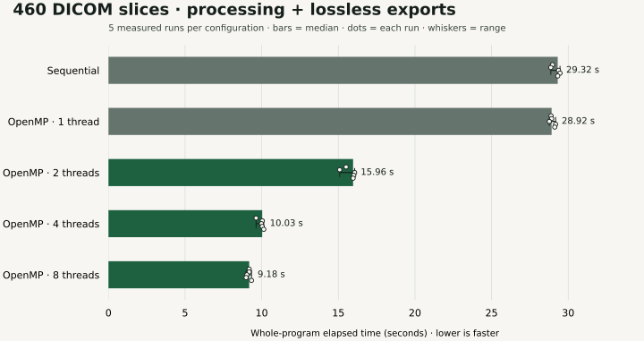
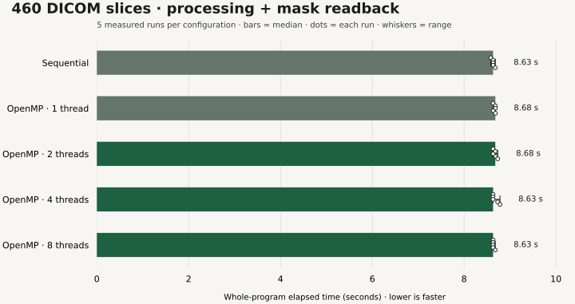

# Verified October 2026 benchmark

**The full processing-and-lossless-export workload achieved 3.15× throughput with eight OpenMP threads**, reducing median whole-program elapsed time from **28.917 to 9.182 seconds (68.25%)** on the original laptop. This is a 2026 refresh result. The historical report and résumé figures are not used as evidence.

The processing-only control showed no meaningful gain from additional threads. The benefit comes from concurrency in host image conversion and export, overlapped with a single GPU producer. It must not be described as a 3.15× acceleration of FAST's segmentation kernels.

## Hardware and fixed conditions

- AMD Ryzen 7 5800U: 8 physical cores / 16 logical CPUs.
- NVIDIA GeForce MX450, 2 GB; driver 610.43.02; FAST 4.10.0 and its OpenCL backend.
- Ubuntu laptop, GCC 13.3.0, CMake Release build, C++17, OpenMP.
- AC power throughout all 60 retained final runs; each run records power and pre-run GPU state. No CPU/GPU clocks were pinned.
- One shared GPU device, staged schedule, batches of 64 spanning patient directories, `OMP_WAIT_POLICY=PASSIVE`.
- The same source snapshot and executable hashes in both experiments. The remote refresh used an isolated source copy without Git metadata, so source/binary SHA-256 manifests identify the measured build rather than a Git commit.

## Workload and timing

The complete original curated inventory contains **460 T1 post-contrast DICOM slices from 20 patient directories** in TCIA Brain-Tumor-Progression. Both experiments have the same input-manifest hash. No patient subset or favorable slice selection is used.

Every slice runs DICOM import, normalization, clipping, vector median filtering, sharpening, seeded region growing, uint8 cast, dilation, synchronized host readback, and a raw-mask fingerprint. Pipeline parameters are shared between execution modes and match the 2025 batch code.

The export workload additionally writes **one raw PGM mask and two 512-pixel PNG previews per slice: 1,380 files per run**. Preview conversion uses the same code, scaling, and lossless formats in every configuration. The original 2025 program exported JPEG renderings through a different renderer; these new measurements are comparisons within the refreshed implementation, not a measured speedup over the old application.

The primary timer is Python `perf_counter` around the complete subprocess: startup, input discovery, processing, readback, enabled exports, report writing, and shutdown. Python's timeout wait can add polling latency up to roughly 50 ms; sub-percent differences are not interpreted as gains. The internal C++ processing timer is retained separately.

Each experiment records **one warmup and five measured repetitions for each of five configurations**. Warmups are retained and excluded from medians. Configuration order is shuffled within each measured round using seed 20261002. No measured outliers or slower configurations are discarded.

The baseline is the **one-worker OpenMP runner**, isolating thread-count changes within the same executable. The separate sequential executable is reported as an additional check. A one-worker staged run finishes each slice immediately, matching the sequential workflow; exports are not deliberately deferred to inflate the baseline.

## Processing and lossless export

| Configuration | Median (s) | Range (s) | Throughput vs. OpenMP 1 |
|---|---:|---:|---:|
| Sequential | 29.316 | 28.866–29.467 | 0.986× |
| OpenMP 1 thread | 28.917 | 28.768–29.178 | 1.000× |
| OpenMP 2 threads | 15.963 | 15.090–16.063 | 1.811× |
| OpenMP 4 threads | 10.032 | 9.633–10.134 | 2.882× |
| OpenMP 8 threads | 9.182 | 8.981–9.331 | 3.149× |

Eight-thread throughput is about **50.1 slices/second**, compared with **15.9 slices/second** for one worker. Eight threads include the GPU producer and the workers executing export tasks; they are not eight independent GPU pipelines.

All **30 runs**, including warmups, completed all 460 slices. For every run, all 460 mask files and 920 preview files matched the sequential reference **byte for byte by SHA-256**. That is 13,800 completed slice executions and 41,400 exported files inventoried and hashed. No failing run was included.

Public evidence: [every run](../benchmarks/2026-10-02/export-pipeline/runs.json), [summary](../benchmarks/2026-10-02/export-pipeline/summary.json), [environment and binary hashes](../benchmarks/2026-10-02/export-pipeline/metadata.json), [source hashes](../benchmarks/2026-10-02/export-pipeline/source-manifest.json).

## Control: processing and mask readback, exports disabled

| Configuration | Median (s) | Range (s) | Throughput vs. OpenMP 1 |
|---|---:|---:|---:|
| Sequential | 8.631 | 8.580–8.680 | 1.006× |
| OpenMP 1 thread | 8.680 | 8.631–8.682 | 1.000× |
| OpenMP 2 threads | 8.679 | 8.630–8.732 | 1.000× |
| OpenMP 4 threads | 8.631 | 8.628–8.782 | 1.006× |
| OpenMP 8 threads | 8.630 | 8.629–8.679 | 1.006× |

The one-worker median was **8.680 seconds**, versus **8.630 seconds** with eight threads. This difference is within the observed ranges and timer polling resolution. It does not establish a useful GPU-processing gain.

All 30 control runs completed every slice and matched the sequential raw-mask fingerprints. The control masks also match those from the export experiment. The control isolates the processing path; its 8.6-second time must not be compared with the 28.9-second export baseline as if both do the same work.

Public evidence: [every control run](../benchmarks/2026-10-02/processing-only/runs.json), [summary](../benchmarks/2026-10-02/processing-only/summary.json), [environment and hashes](../benchmarks/2026-10-02/processing-only/metadata.json).

## Limits and reproducibility

These are repeated measurements on one laptop and one complete curated workload. They establish an improvement for this implementation and export workload on that machine. Other hardware, input inventories, formats, batch sizes, or background workloads may behave differently. Kernel reuse applies equally to every measured configuration; this experiment does not separately quantify its benefit over the old code.

Matching masks verifies execution-mode equivalence. It does not establish tumor-segmentation accuracy, diagnostic value, or clinical benefit. Seeds and thresholds remain an experimental intensity-based method.

The [collection](https://www.cancerimagingarchive.net/collection/brain-tumor-progression/) has controlled-access terms. Public evidence contains aggregate timings, environment, counts, verification outcomes, and hashes binding it to private reports. The benchmark evidence excludes input identifiers, images, individual masks, and per-slice/export manifests. The separate stage-demo video and poster show one original capstone slice and its processing outputs. Full local logs and manifests remain under the laptop's `capstone-refresh-20261002` archive; aggregate evidence alone does not let a reader independently recheck patient pixels. Authorized readers can rerun [the harness](../scripts/benchmark.py) against the curated inventory. The included synthetic fixture provides an integration path independently of data access. The real-scan stage walkthrough is separate from the benchmark evidence.

Earlier shared-device, isolated-context, and mutex experiments were exploratory and sometimes slower or unstable. Battery runs and the trial interrupted during the AC transition are excluded as different conditions. They remain in the local archive and are not presented as final measurements. [Audit and design rationale](2026-refresh.md).

Dataset citation: Schmainda, K. M., & Prah, M. (2018). *Data from Brain-Tumor-Progression*. The Cancer Imaging Archive. [doi:10.7937/K9/TCIA.2018.15quzvnb](https://doi.org/10.7937/K9/TCIA.2018.15quzvnb).

## Supported résumé wording

> Refreshed a C++/FAST pipeline in 2026 to overlap GPU processing with OpenMP export tasks, achieving 3.15× throughput for processing and lossless export of 460 DICOM slices with byte-identical outputs across five measured repetitions.

Pair this with the original four-person capstone context. Keep the 2026 date and export scope; retire the unsupported historical 1.25× figure and unverified leadership claim.
